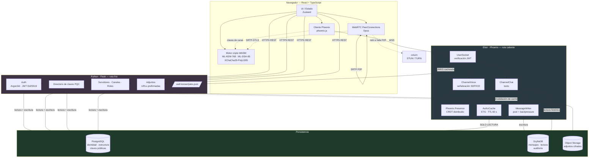
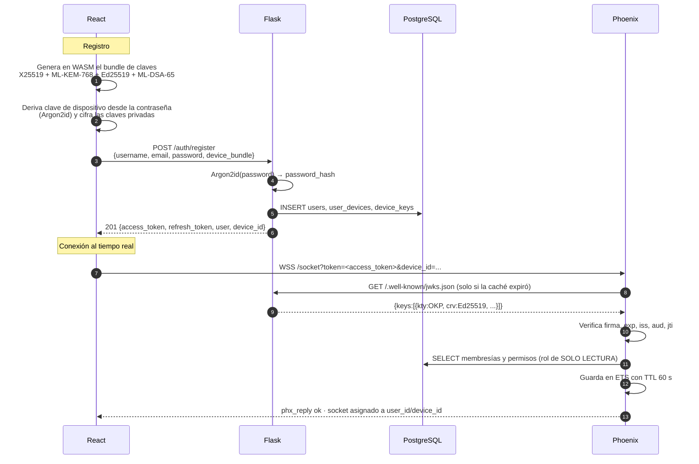
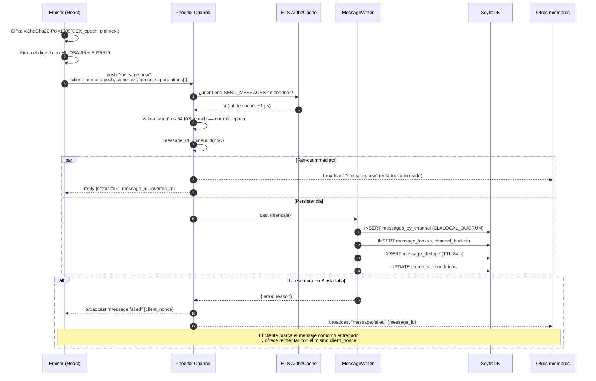
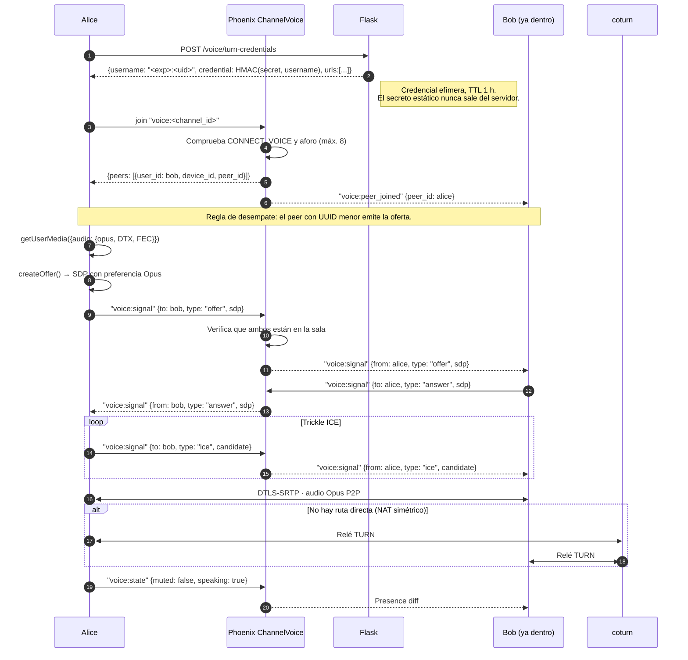
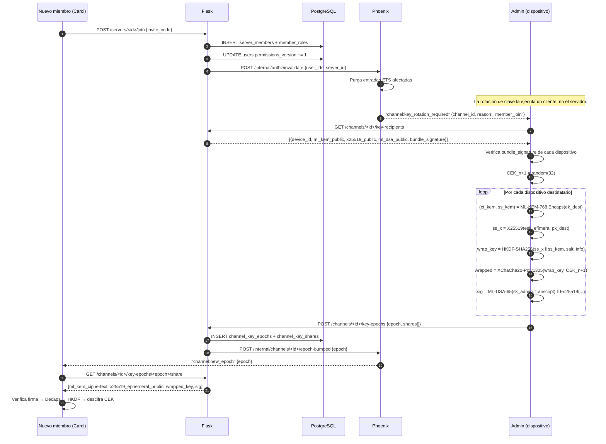
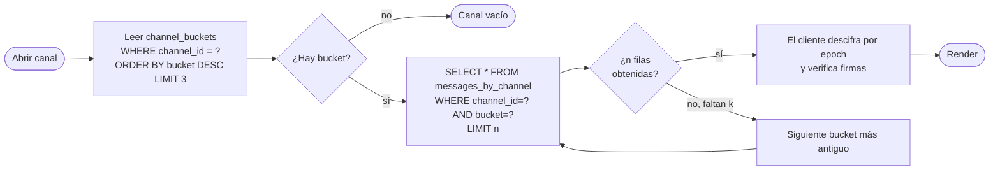
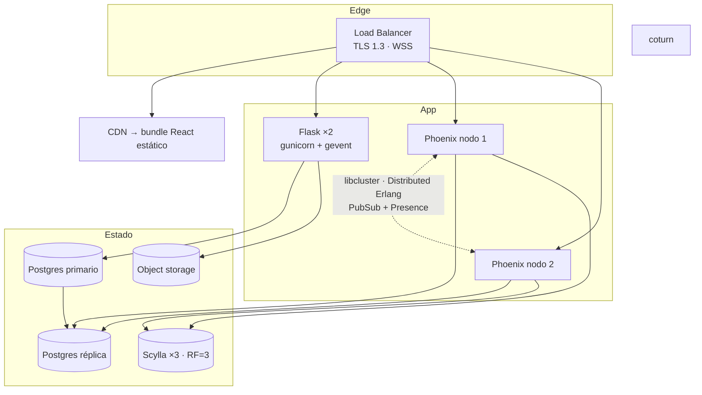

# FASE 1 — Arquitectura global y flujos de datos

## 1. Principios que gobiernan el diseño

1. **Un único escritor por dato.** Cada tabla tiene exactamente un servicio que
   escribe en ella. Postgres lo escribe Flask; Scylla lo escribe Phoenix. Evita
   el infierno de la doble escritura sin necesitar transacciones distribuidas.
2. **La ruta caliente no llama a la ruta fría.** Enviar un mensaje no puede
   depender de una llamada HTTP a Flask. Phoenix valida el JWT localmente y
   resuelve permisos desde su propia caché.
3. **El servidor no puede leer el contenido.** Phoenix enruta y persiste
   *ciphertext*. Todo lo que necesita para autorizar (autor, canal, menciones)
   viaja en claro como metadato; el cuerpo no.
4. **La media nunca toca el servidor.** WebRTC P2P en malla; Phoenix solo mueve
   SDP e ICE. TURN existe como relé de último recurso, no como ruta normal.
5. **Cripto híbrida, no PQC pura.** X25519+ML-KEM-768 y Ed25519+ML-DSA-65. Si
   uno de los dos esquemas cae, el otro sigue protegiendo. Ver
   [ADR-0003](../adr/0003-criptografia-hibrida-pqc.md).

---

## 2. Vista de componentes

### Por qué dos backends y no uno

Elixir y Flask no compiten: resuelven problemas con perfiles de carga opuestos.

| | Phoenix (Elixir) | Flask (Python) |
|---|---|---|
| Perfil | 10⁴ conexiones persistentes, mensajes de ~1 KB | decenas de req/s, lógica compleja |
| Latencia objetivo | p99 < 20 ms de fan-out | p99 < 200 ms |
| Estado | con estado (canales, presencia) | sin estado (escala horizontal trivial) |
| Escribe en | ScyllaDB | PostgreSQL |
| Falla si cae | se corta el tiempo real; el histórico sigue accesible | no se puede crear/administrar; el chat sigue vivo |

La última fila es el argumento decisivo: **fallan de forma independiente**. Si
Flask cae, los usuarios ya conectados siguen hablando; sus JWT son válidos hasta
15 minutos y Phoenix no necesita a Flask para enrutar.

---

## 3. Autenticación: quién emite y quién verifica

Flask es la **única autoridad de identidad**. Firma JWT con Ed25519 (`EdDSA`) y
publica la clave pública en `/.well-known/jwks.json`. Phoenix descarga ese JWKS,
lo cachea 5 minutos y verifica **en local** cada conexión de socket. Ninguna
conexión WebSocket genera una llamada HTTP a Flask.

**Claims del JWT** — el detalle exacto está en
[04-contratos-entre-servicios.md](04-contratos-entre-servicios.md#1-jwt).
El token lleva `sub` (user_id), `did` (device_id) y `ver` (version de permisos),
pero **no lleva la lista de permisos**: cabría en el token, pero entonces
revocar un rol tardaría hasta 15 minutos en surtir efecto. En su lugar Phoenix
consulta y cachea 60 segundos.

---

## 4. Flujo: enviar un mensaje de texto

**La decisión discutible, hecha explícita:** difundimos *antes* de confirmar la
escritura en Scylla. Eso baja el p99 percibido de ~15 ms a ~3 ms, a cambio de
una ventana en la que un mensaje se ve en pantalla y luego se retracta si la
escritura falla. Para un grupo reducido y un fallo raro, es el intercambio
correcto; el mecanismo de retractación (`message:failed`) es obligatorio, no
opcional. Si en el futuro esto molesta, se invierte el orden cambiando una
línea en `MessageWriter` — el contrato del cliente ya contempla los dos estados.

`client_nonce` es un UUIDv4 generado por el cliente. Si el socket se cae entre
el `push` y el `reply`, el reintento trae el mismo nonce, `message_dedupe` lo
detecta y devuelve el `message_id` original en lugar de duplicar. Sin esto, cada
reconexión en un tren de metro genera mensajes dobles.

---

## 5. Flujo: unirse a un canal de voz (WebRTC en malla)

Phoenix **no interpreta el SDP**: solo comprueba que emisor y receptor están en
la misma sala y reenvía el payload opaco. Eso mantiene el servicio de
señalización independiente de la evolución de WebRTC.

**Selección de códec.** Opus se negocia en el SDP con `useinbandfec=1`,
`usedtx=1`, `maxaveragebitrate=32000` para voz. DTX corta la transmisión en
silencio, lo que en una malla de N peers importa: el ancho de banda de subida
crece con O(N), y en una llamada real la mayoría está callada la mayor parte
del tiempo.

---

## 6. Flujo: establecer la clave de un canal (pipeline PQC)

Resumen aquí; el detalle criptográfico completo está en
[03-seguridad-pqc.md](03-seguridad-pqc.md).

Dos propiedades importantes de este diseño:

- **El servidor almacena, no participa.** Flask guarda `wrapped_key` sin poder
  abrirla. Nunca ve una CEK ni una clave privada.
- **La rotación es sincrónica con la membresía, no periódica.** Cada
  alta/baja produce una época nueva. Un miembro expulsado conserva las claves
  de las épocas en que estuvo (no hay borrado retroactivo posible en E2EE),
  pero no puede leer nada posterior: *post-compromise security* a nivel de
  membresía.

---

## 7. Ruta de lectura: cargar el histórico de un canal

Un cliente que abre un canal pide los últimos 50 mensajes y luego pagina hacia
atrás. En Scylla eso no es un `OFFSET`; es un recorrido de particiones.

Paginar hacia atrás desde un mensaje concreto añade
`AND message_id < <timeuuid_cursor>` dentro del mismo bucket. Como el
clustering es `message_id DESC`, es un *range scan* secuencial sobre disco:
la operación más barata que ofrece Scylla.

`channel_buckets` existe precisamente porque un canal puede tener meses sin
actividad. Sin ese directorio, paginar significaría probar mes a mes hacia
atrás a ciegas, gastando una query por cada mes vacío.

---

## 8. Consistencia y modos de fallo

| Escenario | Comportamiento | Recuperación |
|---|---|---|
| Cae un nodo Phoenix | Los clientes reconectan a otro nodo (LB con sticky opcional); Presence converge por CRDT | Automática, ~2 s |
| Cae Flask entero | No hay login ni administración; el chat y la voz siguen | Los JWT vivos duran hasta 15 min |
| Cae un nodo Scylla (RF=3) | `LOCAL_QUORUM` sigue satisfaciéndose con 2 nodos | Hinted handoff + repair |
| Cae Postgres | Phoenix sirve desde caché ETS 60 s, luego rechaza *joins* nuevos | Réplica en espera |
| Partición Phoenix↔Scylla | Las escrituras fallan → `message:failed`; el fan-out sigue funcionando | Reintento del cliente por `client_nonce` |
| Reloj desincronizado entre nodos Phoenix | Los timeuuid podrían desordenarse entre nodos | NTP obligatorio; el orden se define por timeuuid, no por llegada |

**Sobre el orden de los mensajes.** El orden canónico es el `timeuuid` asignado
por el nodo Phoenix que recibe el mensaje. Con varios nodos y relojes con deriva
de milisegundos, dos mensajes casi simultáneos pueden ordenarse distinto de como
los vio un observador humano. Para un grupo reducido esto es invisible y no
justifica el coste de un secuenciador central. Queda documentado como límite
conocido, no como bug.

---

## 9. Presupuesto de latencia (objetivo p99, un solo DC)

| Tramo | Presupuesto |
|---|---|
| Cifrado en cliente (XChaCha20 + ML-DSA-65 sign) | 2 ms |
| RTT WebSocket cliente→Phoenix | 8 ms |
| Autorización (ETS hit) | < 0.1 ms |
| Fan-out PubSub a N≤8 suscriptores | 1 ms |
| RTT Phoenix→cliente receptor | 8 ms |
| Descifrado + verificación en cliente | 3 ms |
| **Total percibido emisor→receptor** | **~22 ms** |
| Escritura Scylla `LOCAL_QUORUM` (fuera de la ruta percibida) | 6 ms |

La firma ML-DSA-65 es lo más caro del cliente (~1 ms en WASM, y 3309 bytes de
firma por mensaje). Ver [ADR-0003](../adr/0003-criptografia-hibrida-pqc.md) para
por qué firmamos igualmente cada mensaje en lugar de solo autenticar con el AEAD.

---

## 10. Despliegue

Phoenix se agrupa con `libcluster`; `Phoenix.PubSub` y `Phoenix.Presence`
replican entre nodos por Distributed Erlang, así que un usuario en el nodo 1 y
otro en el nodo 2 comparten canal sin infraestructura adicional. Esto es lo que
hace que no necesitemos Redis para el fan-out.

---

## 11. Qué NO decide esta fase

Deliberadamente aplazado, con el punto de decisión anotado:

- **SFU.** Cuando la malla deje de aguantar (>8 participantes), se introduce un
  SFU y la señalización cambia de N×N a 1×N. La capa de señalización de la
  FASE 2 está diseñada para que ese cambio no toque el contrato del cliente.
- **Búsqueda de mensajes.** Imposible en servidor con E2EE. Será un índice
  local en el cliente (IndexedDB) en una fase posterior.
- **Multi-región.** El esquema de Scylla ya usa `NetworkTopologyStrategy` y
  `LOCAL_QUORUM`, así que añadir un DC es una operación de infraestructura, no
  una migración de datos.

---

**Siguiente:** [02 — Modelo de datos](02-modelo-de-datos.md)
