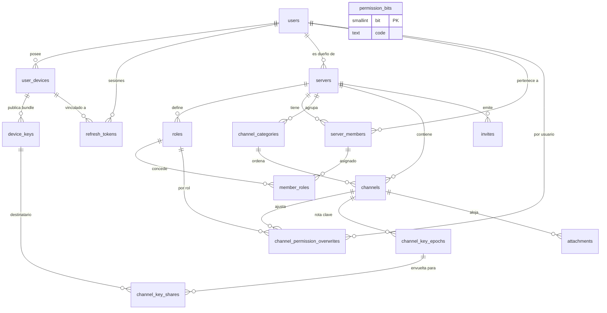
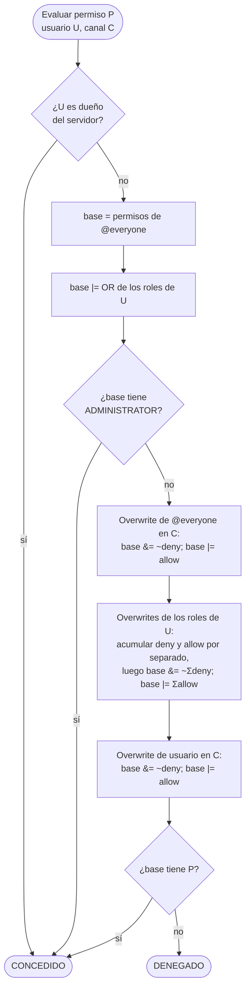
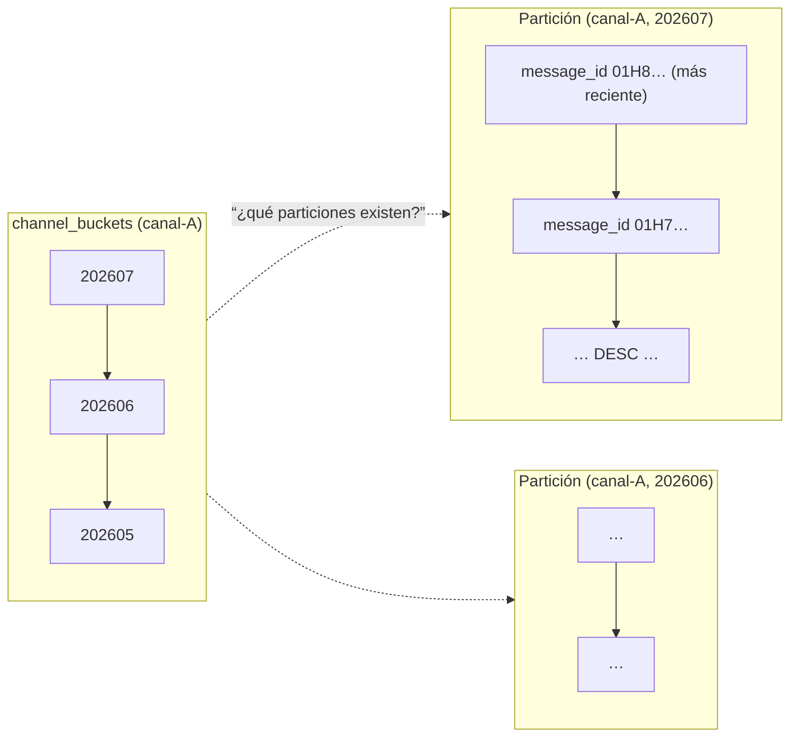

# FASE 1 — Modelo de datos

## 1. El reparto: qué vive dónde

La pregunta no es "¿SQL o NoSQL?" sino "¿este dato tiene relaciones que hay que
mantener íntegras, o es un flujo que hay que escribir muy rápido y leer por
rango?". Cada dato responde solo a una de las dos.

| Dato | Base | Por qué |
|---|---|---|
| Usuarios, dispositivos, tokens | Postgres | Unicidad de username/email, cascadas, transacciones |
| Servidores, canales, roles, membresías | Postgres | Grafo relacional; se lee mucho, se escribe poco |
| Overwrites de permisos | Postgres | Se resuelven con JOINs; volumen minúsculo |
| Claves públicas PQC, épocas, shares | Postgres | Integridad crítica; una FK rota aquí es un canal ilegible |
| Metadatos de adjuntos | Postgres | Máquina de estados (pending→ready) con transacciones |
| **Mensajes** | Scylla | Escritura intensiva, lectura por rango temporal, sin JOINs |
| Estado de lectura, no leídos | Scylla | Escritura constante, tolerante a aproximación |
| Reacciones | Scylla | Alta rotación, partición por mensaje |
| Auditoría, telemetría de voz | Scylla | Solo append, con TTL |

**La regla que no se rompe:** ninguna consulta cruza las dos bases. Cuando un
mensaje necesita datos de perfil (nombre, avatar), el cliente los resuelve
contra su caché de miembros, que obtuvo de Flask. El servidor nunca hace un
"join" entre Scylla y Postgres.

`attachments.message_id` es `text`, no una FK: apunta a un `timeuuid` que vive
en Scylla. Esa columna es el único punto donde las dos bases se referencian, y
está deliberadamente sin restricción de integridad porque no puede tenerla. La
consecuencia (un adjunto huérfano si el mensaje falla al escribirse) se recoge
con el job de limpieza de `state = 'pending'`.

---

## 2. PostgreSQL

### Diagrama entidad-relación



### Decisiones que merecen explicación

**Borrado en blando con índices únicos parciales.** `users.deleted_at` más
`CREATE UNIQUE INDEX ... WHERE deleted_at IS NULL`. Una cuenta borrada libera
su username para que otro lo tome, pero sus filas siguen existiendo y las FK de
mensajes históricos no se rompen. Un `UNIQUE` normal impediría lo primero; un
borrado duro rompería lo segundo.

**`permission_bits` es una tabla, no un `enum`.** La UI de administración tiene
que listar permisos con etiquetas legibles y descripciones. Un `enum` de
Postgres no lleva metadatos y añadir un valor requiere `ALTER TYPE`, que no se
puede hacer dentro de una transacción en versiones antiguas. Una tabla de
catálogo resuelve las dos cosas.

**La máscara válida está escrita a mano, no derivada.** `permissions_mask_all()`
devuelve `131071` literal. Sería más elegante calcularlo con
`SELECT sum(1<<bit) FROM permission_bits`, pero una restricción `CHECK` que
consulta otra tabla no es determinista y falla al restaurar un `pg_dump` si el
orden de carga no coopera. La duplicación se controla con un bloque `DO` en la
migración que aborta si la constante y el catálogo divergen.

**`member_roles` lleva un trigger además de las FK.** La clave foránea compuesta
`(server_id, user_id) → server_members` garantiza que el miembro existe, y
`role_id → roles` que el rol existe — pero nada impide combinar un miembro del
servidor A con un rol del servidor B. El trigger `member_roles_same_server()`
cierra ese hueco. Es el tipo de invariante que una aplicación "siempre
respeta"… hasta el día que un script de migración no lo hace.

**Los overwrites usan dos índices únicos parciales, no una PK.** La tabla apunta
a un rol *o* a un usuario, nunca a los dos (`num_nonnulls(role_id, user_id) = 1`).
Una clave primaria sobre columnas nullable no impone unicidad como se esperaría,
así que la unicidad se declara por separado para cada caso.

### Resolución de permisos

Tres capas, en este orden exacto. Cambiar el orden cambia la semántica.



Dos detalles con consecuencias prácticas:

- **ADMINISTRATOR corta la evaluación antes de los overwrites.** Un
  administrador no puede quedar excluido de un canal por un overwrite. Eso
  evita el fallo clásico de bloquearse a uno mismo fuera de su propio servidor.
- **Los denys de rol se acumulan y se aplican todos antes que los allows de
  rol.** Si el rol A deniega `SEND_MESSAGES` y el rol B lo permite, **gana el
  permiso**. Es la convención de Discord y la que espera cualquiera que haya
  administrado uno. La alternativa (deny gana) es igual de defendible pero
  sorprende al usuario.

La vista `member_server_permissions` resuelve las capas 1 y 2. La capa 3 se
aplica en la aplicación porque depende del canal concreto que se evalúa.

### Invalidación de la caché de autorización

Phoenix cachea permisos en ETS con TTL de 60 segundos. Sesenta segundos de
retraso al expulsar a alguien es demasiado, así que hay un camino explícito:

1. Flask modifica roles o membresías e incrementa `users.permissions_version`.
2. Flask hace `POST /internal/authz/invalidate` a Phoenix con los `user_id`.
3. Phoenix purga las entradas ETS afectadas y, si el usuario perdió acceso a un
   canal, lo expulsa del `Phoenix.Channel` correspondiente.

El TTL de 60 s es la red de seguridad para cuando esa llamada falla, no el
mecanismo principal. `permissions_version` viaja en el JWT: si Phoenix ve un
token con una versión anterior a la que tiene cacheada, refresca sin esperar al
TTL.

---

## 3. ScyllaDB

### Las particiones, dibujadas



### Tabla por tabla

| Tabla | Clave de partición | Clustering | Patrón que sirve |
|---|---|---|---|
| `messages_by_channel` | `(channel_id, bucket)` | `message_id DESC` | Últimos N; paginar hacia atrás |
| `message_lookup` | `message_id` | — | Editar/borrar/citar con solo el id |
| `channel_buckets` | `channel_id` | `bucket DESC` | ¿Qué particiones tiene este canal? |
| `message_dedupe` | `(channel_id, client_nonce)` | — | Idempotencia del reenvío |
| `channel_read_state` | `user_id` | `channel_id` | Todo mi estado de lectura de una vez |
| `channel_unread_counters` | `user_id` | `channel_id` | Badges |
| `reactions_by_message` | `message_id` | `emoji, user_id` | Reacciones de los mensajes visibles |
| `user_channel_index` | `user_id` | `server_id, channel_id` | Qué suscribir al conectar |
| `server_audit_log` | `(server_id, bucket)` | `event_id DESC` | Auditoría reciente |
| `voice_session_events` | `(channel_id, day_bucket)` | `event_id DESC` | Depurar WebRTC |

### El bucket: por qué existe y cómo se calcula

Sin bucket, la clave de partición sería solo `channel_id` y un canal de dos
años sería **una partición** creciendo sin techo. Esa es la forma canónica de
inutilizar un clúster de Cassandra/Scylla: particiones enormes disparan la
latencia de lectura, la presión de memoria en compactación y los tiempos de
reparación.

El bucket es `AAAAMM` (entero, p. ej. `202607`). Con el perfil de este producto
—grupo reducido, ~4 KiB por mensaje, dominados por los 3373 B de firma
híbrida— una partición mensual muy activa
ronda unos pocos MB, muy por debajo del umbral práctico de 100 MB.

```python
# Debe dar el mismo resultado en Elixir y en Python. Es la única función
# duplicada entre servicios a propósito; cualquier divergencia parte el
# histórico de un canal en dos.
def bucket_for(ts_utc) -> int:
    return ts_utc.year * 100 + ts_utc.month
```

```elixir
def bucket_for(%DateTime{} = ts), do: ts.year * 100 + ts.month
```

**Si un canal creciera más de lo previsto**, el cambio es a bucket diario
(`AAAAMMDD`) *solo para los buckets nuevos*. El código de lectura ya recorre
`channel_buckets` en vez de calcular buckets, así que buckets viejos mensuales
y nuevos diarios conviven sin migrar un solo byte. Esa es exactamente la razón
de que `channel_buckets` exista en lugar de derivar los buckets aritméticamente.

### Elección de estrategia de compactación

| Tabla | Estrategia | Razón |
|---|---|---|
| `messages_by_channel` | TWCS, ventana 7 d | Escritura secuencial en el tiempo; las SSTables viejas se vuelven inmutables de hecho |
| `server_audit_log`, `voice_*` | TWCS + TTL | Con TTL uniforme, una SSTable entera caduca a la vez y se descarta sin compactar |
| `channel_read_state`, `reactions_by_message` | LCS | Sobrescritura y borrado constantes; LCS acota cuántas SSTables toca una lectura |

TWCS en `messages_by_channel` tiene una pega honesta: editar un mensaje viejo
es un `UPDATE` sobre una ventana ya cerrada, que TWCS maneja mal en teoría. A
este volumen y con ediciones raras, la fragmentación resultante es
irrelevante. Si el patrón cambiara, STCS sería la alternativa.

### Contadores: aproximados a sabiendas

`channel_unread_counters` usa el tipo `counter`. Los contadores de
Cassandra/Scylla **no son idempotentes**: un incremento que sufre timeout y se
reintenta puede contarse dos veces. Para un badge de no leídos es aceptable —
se corrige solo en cuanto el usuario abre el canal y se hace reset. Para algo
que exigiera exactitud (saldos, cuotas) este sería el enfoque equivocado y
habría que ir a Postgres.

Restricción del motor, no decisión de diseño: una tabla con columnas `counter`
no puede tener otras columnas fuera de la clave primaria. Por eso los
contadores están separados de `channel_read_state`.

### Niveles de consistencia

| Operación | CL | Razón |
|---|---|---|
| Escribir mensaje | `LOCAL_QUORUM` | Un mensaje perdido es un fallo visible |
| Leer histórico | `LOCAL_QUORUM` | Evita mostrar huecos tras un fallo de nodo |
| `message_dedupe` lectura/escritura | `LOCAL_QUORUM` | Si falla, se duplica un mensaje |
| Estado de lectura | `LOCAL_ONE` | Barato y tolerante a desfase |
| Contadores | `LOCAL_QUORUM` | Ya son imprecisos; no empeoremos |
| Telemetría | `ANY` | Perder una línea de log no importa |

`LOCAL_*` y no `QUORUM` global: con RF=3 en un DC, `LOCAL_QUORUM` son 2 nodos
del DC local. Añadir un segundo DC no cambia la latencia de escritura.

---

## 4. Lo que este modelo NO permite

Explícito para que nadie lo descubra a mitad de la FASE 3:

- **Buscar mensajes por contenido.** Imposible en servidor: el servidor solo
  tiene ciphertext. Será un índice local en el cliente (IndexedDB).
- **Listar los mensajes de un autor concreto.** Haría falta una tabla
  `messages_by_author`. No es un caso de uso del MVP; añadirla es pagar una
  escritura extra por mensaje para una lectura que nadie hace.
- **Contar mensajes de un canal con exactitud.** `channel_buckets.message_count`
  es un contador y por tanto aproximado.
- **Borrado retroactivo real.** Un miembro expulsado conserva las claves de las
  épocas en que estuvo. Ninguna arquitectura E2EE puede quitarle lo que ya
  descifró; lo que sí se garantiza es que no lee nada posterior a su salida.

---

**Siguiente:** [03 — Seguridad y PQC](03-seguridad-pqc.md)
