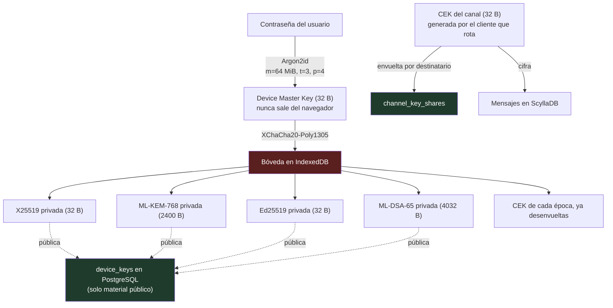
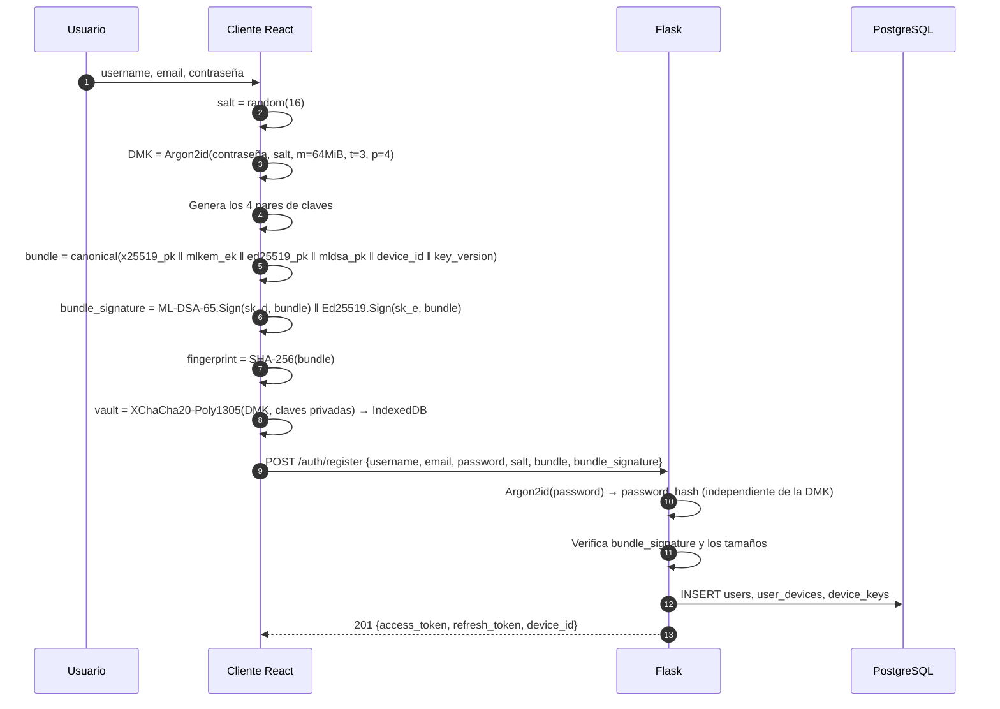
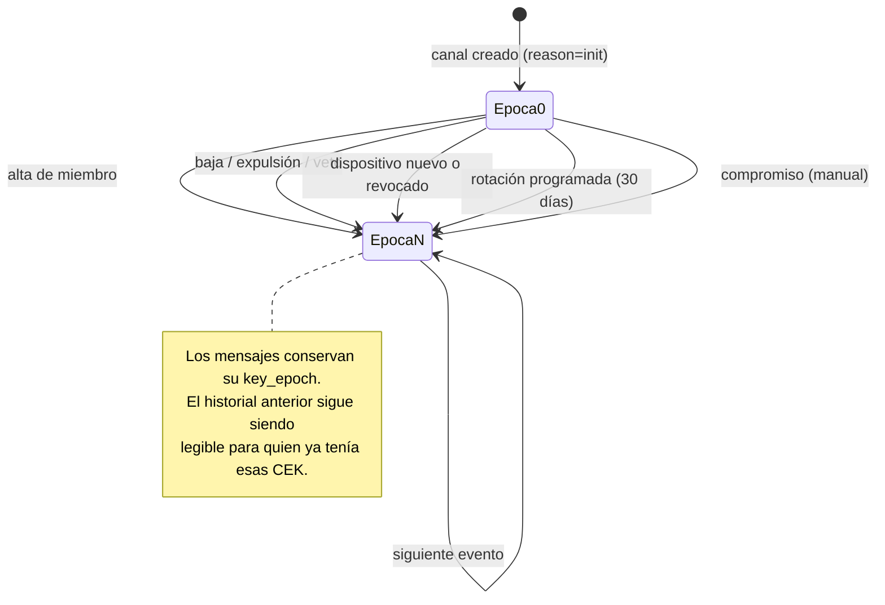

# FASE 1 — Seguridad y criptografía post-cuántica

## 1. Modelo de amenazas

Lo que el diseño protege, y contra quién.

| Adversario | Capacidad | ¿Protegido? |
|---|---|---|
| Observador de red | Ve todo el tráfico TLS | Sí — TLS 1.3 + E2EE debajo |
| Adversario "cosecha hoy, descifra mañana" | Guarda tráfico ahora, tiene un ordenador cuántico en 2035 | **Sí — esta es la amenaza que motiva el PQC** |
| Servidor curioso (operador honesto pero fisgón) | Lee toda la base de datos | Sí para el contenido; **no** para los metadatos |
| Servidor comprometido (activo) | Puede sustituir claves públicas | Detectable: los bundles van autofirmados y hay huellas verificables |
| Miembro malicioso del canal | Tiene la CEK vigente | No, y no puede protegerse: es un participante legítimo |
| Miembro expulsado | Tenía la CEK de épocas pasadas | Sí hacia delante — no lee nada tras la rotación |
| Atacante con el dispositivo desbloqueado | Acceso a IndexedDB | No — límite conocido, ver §7 |

**La amenaza que justifica todo esto** es la primera de las que importan a
futuro: alguien que archive tráfico cifrado hoy y lo descifre cuando existan
ordenadores cuánticos criptográficamente relevantes. Un mensaje que sigue
siendo sensible dentro de diez años necesita protección post-cuántica **hoy**,
porque el archivado ya está ocurriendo. Esa es la única razón por la que un MVP
para un grupo pequeño se molesta en usar ML-KEM.

---

## 2. Primitivas

| Función | Clásico | Post-cuántico | Combinación |
|---|---|---|---|
| Acuerdo de clave | X25519 | ML-KEM-768 (FIPS 203) | Híbrido, ambos secretos al KDF |
| Firma | Ed25519 | ML-DSA-65 (FIPS 204) | Híbrido, se concatenan y se exigen las dos |
| Cifrado simétrico | XChaCha20-Poly1305 | *(ya resistente)* | — |
| Derivación | HKDF-SHA256 | *(ya resistente)* | — |
| Hash de contraseña | Argon2id | *(ya resistente)* | — |

**Por qué híbrido y no PQC puro.** ML-KEM y ML-DSA son estándares NIST pero
tienen mucho menos escrutinio acumulado que X25519 y Ed25519. Un fallo
estructural en la criptografía basada en retículos no es imposible. En el
esquema híbrido, romper el sistema exige romper **las dos** primitivas: se
suman las garantías en lugar de sustituirlas. El coste es tamaño y algo de CPU,
que a esta escala no se nota. Detalle en
[ADR-0003](../adr/0003-criptografia-hibrida-pqc.md).

**Por qué el nivel 3 (ML-KEM-768 / ML-DSA-65) y no el 5.** Nivel 3 ≈ AES-192.
El nivel 5 duplica los tamaños para proteger contra un adversario que, si
existiera, tendría objetivos bastante más interesantes que un chat de grupo.
Nivel 3 es lo que recomienda el propio NIST como opción general.

### Tamaños (los que imponen las restricciones del esquema)

| Elemento | Bytes |
|---|---|
| ML-KEM-768 clave de encapsulación (pública) | 1184 |
| ML-KEM-768 clave de decapsulación (privada) | 2400 |
| ML-KEM-768 texto cifrado | 1088 |
| ML-DSA-65 clave de verificación (pública) | 1952 |
| ML-DSA-65 clave de firma (privada) | 4032 |
| ML-DSA-65 firma | 3309 |
| X25519 clave pública / secreto compartido | 32 |
| Ed25519 clave pública / firma | 32 / 64 |
| **Firma híbrida (ML-DSA-65 ‖ Ed25519)** | **3373** |

Estos números están codificados como restricciones `CHECK` en
[`0003_pqc_key_directory.sql`](../../db/postgres/migrations/0003_pqc_key_directory.sql).
Una clave del tamaño equivocado no llega a la base de datos.

---

## 3. Jerarquía de claves



Verde = lo que el servidor almacena. Rojo = lo que jamás sale del navegador.

---

## 4. Registro y publicación de claves



Dos hashes de contraseña distintos y ninguno derivable del otro: el del servidor
(`users.password_hash`) autentica; el del cliente (DMK) cifra la bóveda local.
El servidor nunca ve la DMK, así que ni siquiera un servidor malicioso puede
abrir la bóveda de nadie.

`bundle_signature` es la defensa contra un servidor que sustituya claves
públicas: como el bundle se autofirma, cambiar cualquier clave invalida la
firma y el cliente que va a encapsular lo detecta. No impide que el servidor
sirva un bundle *entero* falso (ataque de sustitución de identidad) — eso solo
lo detecta la comparación de huellas fuera de banda, que la UI expone.

---

## 5. Establecimiento de la clave de canal (KEM híbrido)

### El combinador

```
Para cada dispositivo destinatario R:

  (ct_kem, ss_kem) ← ML-KEM-768.Encaps(ek_R)
  (esk, epk)       ← X25519.KeyGen()
  ss_x             ← X25519.DH(esk, pk_R)

  wrap_key ← HKDF-SHA256(
      ikm  = ss_x ‖ ss_kem,
      salt = epoch.hkdf_salt,
      info = "jackal/v1/cek-wrap"
             ‖ channel_id ‖ epoch ‖ recipient_device_id
             ‖ pk_R ‖ ek_R ‖ epk ‖ ct_kem,
      len  = 32
  )

  wrapped_cek ← XChaCha20-Poly1305(wrap_key, nonce, CEK)
  sender_sig  ← ML-DSA-65.Sign(sk_A, T) ‖ Ed25519.Sign(sk_A, T)
      donde T = SHA-256(channel_id ‖ epoch ‖ recipient_device_id
                        ‖ ct_kem ‖ epk ‖ wrapped_cek ‖ nonce)
```

Tres decisiones concretas en ese bloque:

1. **Los dos secretos entran juntos al HKDF** (`ikm = ss_x ‖ ss_kem`). Es la
   construcción de "combinador de KEM" segura: la clave resultante es tan
   fuerte como el más fuerte de los dos, no como el más débil.
2. **El `info` incluye las claves públicas y los textos cifrados.** Sin eso,
   el esquema es vulnerable a reencapsulación: un atacante que reutilice un
   `ct_kem` en otro contexto obtendría la misma `wrap_key`. Atar la derivación
   al transcript completo lo cierra.
3. **Se firma el transcript, no la CEK.** Firmar la CEK la expondría a quien
   verifique. El transcript ata emisor, destinatario, canal y época sin
   revelar nada.

### Rotación: cuándo, y quién



La rotación la ejecuta **un cliente**, no el servidor — el servidor no puede,
no tiene la CEK. Eso plantea dos problemas que hay que resolver
explícitamente:

**¿Quién rota?** Si dos administradores rotan a la vez, se crean dos CEK
distintas para la misma época y el canal se parte en dos. La solución es doble:
Phoenix designa un único rotador (el dispositivo conectado con permiso
`ROTATE_CHANNEL_KEY` y `device_id` menor) y le envía el aviso solo a él; y por
si eso falla, la clave primaria `(channel_id, epoch)` de `channel_key_epochs`
hace que la segunda escritura falle. El perdedor reintenta con `epoch + 1`.

**¿Y si no hay nadie conectado que pueda rotar?** El canal sigue funcionando en
la época actual. La rotación se aplaza hasta que un dispositivo con permiso se
conecte. Consecuencia asumida: un miembro expulsado mientras todos los
administradores están desconectados podría seguir leyendo hasta que alguno
vuelva. La alternativa —que el servidor rote— exigiría darle la CEK, que es
justo lo que este diseño evita.

### Recogida de la clave por el destinatario

```
share ← GET /channels/{id}/key-epochs/{epoch}/share

1. Verificar sender_signature contra el bundle del emisor.
   Si falla → abortar y avisar en la UI. NO intentar descifrar.
2. ss_kem ← ML-KEM-768.Decaps(dk_R, ct_kem)
3. ss_x   ← X25519.DH(sk_R, epk)
4. wrap_key ← HKDF-SHA256(...)   [mismo info que el emisor]
5. CEK ← XChaCha20-Poly1305.Open(wrap_key, nonce, wrapped_cek)
6. Comprobar SHA-256(CEK) == epoch.cek_commitment
   Si no coincide → el servidor repartió CEK distintas. Abortar.
7. Guardar CEK en la bóveda de IndexedDB.
```

El paso 6 es lo que impide que un servidor malicioso **particione el canal**
dándole a un subgrupo una CEK y a otro subgrupo otra. Como `cek_commitment` es
uno solo por época y todos lo leen, la discrepancia se detecta.

---

## 6. Cifrado de mensajes

```
AAD  = "jackal/v1/msg" ‖ channel_id ‖ epoch ‖ author_device_id ‖ client_nonce
nonce = random(24)
ciphertext = XChaCha20-Poly1305(CEK_epoch, nonce, plaintext, AAD)
T = SHA-256(AAD ‖ nonce ‖ ciphertext)
sender_signature = ML-DSA-65.Sign(sk_autor, T) ‖ Ed25519.Sign(sk_autor, T)
```

**Por qué se firma cada mensaje si el AEAD ya autentica.** Porque en un canal
de grupo todos comparten la misma CEK: el AEAD solo demuestra "esto lo escribió
*alguien que tiene la clave del canal*". Sin firma, cualquier miembro podría
fabricar un mensaje atribuido a otro y nadie lo distinguiría. La firma da
autenticidad **por emisor**, que es lo que la UI está afirmando cuando pone un
nombre junto a un mensaje.

**El coste, dicho sin adornos:** 3373 bytes de firma por mensaje. Un mensaje de
veinte caracteres pasa a ocupar unos 3,5 KiB — cerca de cien veces su tamaño
útil. A la escala de este producto (un grupo reducido; mil mensajes al día son
~3,5 MB/día) es perfectamente asumible, y por eso la decisión es firmar
siempre. En un producto con millones de mensajes diarios habría que ir a firmas
por lotes o a un esquema de cadena tipo ratchet, y eso cambiaría el modelo de
datos. Queda anotado como el punto donde este diseño dejaría de escalar.

`XChaCha20-Poly1305` y no `AES-256-GCM` por el nonce de 24 bytes: permite
generarlo aleatorio sin preocuparse por colisiones. Con los 12 bytes de GCM
haría falta un contador por dispositivo y época, que es estado que se puede
corromper. `AES-256-GCM` queda declarado en el enum `aead_algorithm` como
alternativa si alguna vez interesa la aceleración por hardware.

### Metadatos: lo que el servidor sí ve

Sinceridad sobre el alcance del E2EE. El servidor **no** ve el contenido, pero
**sí** ve:

- quién escribe en qué canal y cuándo (necesario para enrutar)
- a quién se menciona (necesario para las notificaciones)
- a qué mensaje se responde (necesario para ordenar el hilo en la UI)
- el tamaño aproximado del mensaje y de los adjuntos
- quién está en qué canal de voz y durante cuánto tiempo

Eso es un grafo social bastante rico. Ocultarlo exigiría algo tipo Sealed
Sender o mixnets, muy por encima del alcance de un MVP. Está en
`messages_by_channel` como columnas en claro, comentado en el propio esquema.

---

## 7. Límites conocidos

Ninguno de estos es un descuido; todos son decisiones con su razón.

1. **La bóveda depende de la contraseña.** Quien obtenga la contraseña *y* el
   dispositivo abre la bóveda. No hay frase de recuperación separada en el MVP.
   Corolario incómodo: **cambiar la contraseña obliga a redescifrar y
   reenvolver la bóveda con la nueva DMK**, algo que solo puede hacerse con
   sesión iniciada. Olvidar la contraseña significa perder las claves y, con
   ellas, el historial descifrable — no hay recuperación posible por diseño.
2. **Sin verificación de dispositivo fuera de banda obligatoria.** Las huellas
   se muestran en la UI, pero nada obliga a compararlas. Un servidor
   comprometido puede montar un ataque de sustitución de identidad contra
   quien no las compare.
3. **Sin secreto hacia delante por mensaje.** La CEK vive toda una época. Quien
   obtenga una CEK lee todos los mensajes de esa época. Un ratchet doble por
   par de participantes daría PFS por mensaje, a costa de N² estado en un
   grupo — desproporcionado para el MVP.
4. **El historial anterior a la incorporación no se re-cifra.** Un miembro
   nuevo no puede leer lo de antes (no tiene esas CEK). Es intencional, pero
   significa que "invitar a alguien al canal" no le da el contexto previo.
5. **Los metadatos están en claro.** §6.
6. **La rotación depende de que haya un cliente conectado.** §5.

---

## 8. Bibliotecas propuestas

| Dónde | Necesita | Propuesta |
|---|---|---|
| React | ML-KEM, ML-DSA, X25519, Ed25519, XChaCha20, HKDF, Argon2id | `@noble/post-quantum`, `@noble/curves`, `@noble/ciphers`, `hash-wasm` (Argon2id) |
| Flask | Verificar bundles y firmas de shares | `liboqs-python` (enlaza liboqs); `argon2-cffi` para contraseñas; `PyNaCl` para Ed25519/X25519 |
| Phoenix | **Nada** | Solo mueve blobs opacos. No necesita librería PQC. |

Que Phoenix no necesite criptografía post-cuántica no es casualidad: es la
prueba de que el diseño E2EE es correcto. Si el servicio de tiempo real
necesitara descifrar algo, el cifrado extremo a extremo no lo sería.

En el cliente, `@noble/post-quantum` es JavaScript puro y evita el ciclo de
compilación de WASM; si el rendimiento no llegara, la alternativa es liboqs
compilado a WASM. La verificación en Flask es defensa en profundidad —los
clientes verifican igualmente— pero rechazar un bundle mal formado en el
momento del alta ahorra depurar un canal ilegible tres semanas después.

---

**Siguiente:** [04 — Contratos entre servicios](04-contratos-entre-servicios.md)
